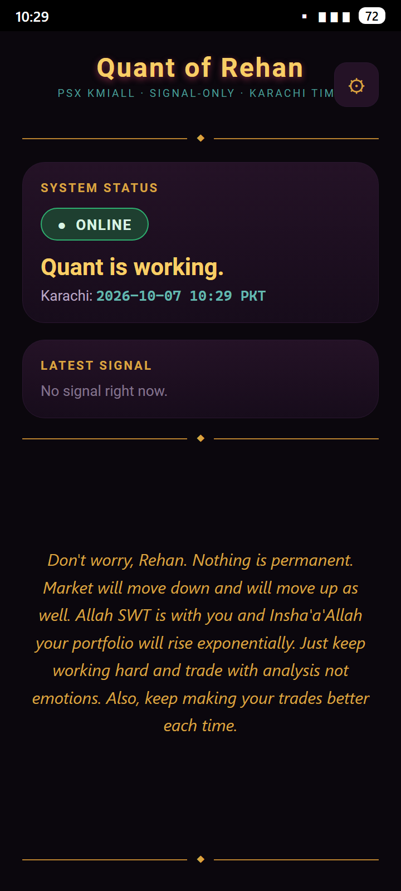

# Quant of Rehan


**Private, signal-only quantitative research platform for PSX KMIALL stocks.**
No order placement. No broker integration for trading. Signals and research
only. Sole contributor and owner: Rehan (muhammadrehanqureshi).

## What is running today

Rebuilt 2026-10-09 around one simple strategy: the fastest current KMIALL
momentum plus volume acceleration, one trade a day, +2% target.

- **One authoritative scanner**: [src/signals/momentum_scanner.py](src/signals/momentum_scanner.py).
  It scores every eligible KMIALL symbol on fast momentum, momentum
  acceleration, relative volume, volume acceleration and liquidity, then
  applies a market-context gate and a late-move decay, and returns exactly
  one winner, NO TRADE, or DATA BLOCKED. The old opening-range library and
  the FVG / sweep daily engine are retired from the trading path.
- **One daily trade state**: [src/signals/trade_state.py](src/signals/trade_state.py).
  A persisted state machine (MARKET_OPEN, SCANNING, TRADE_ENTERED,
  TARGET_MONITORING, TARGET_HIT, DAILY_LOCKED, DATA_BLOCKED) with a hard
  one-trade-per-day lock that survives a process or runner restart.
- **One configuration file**: [src/config.py](src/config.py) holds the
  target, the coverage floor, the score weights and the live-trading switch.
  Live trading is disabled and paper mode is the default.
- **One market clock**: Asia/Karachi UTC+5 forever (SO-8) in
  [src/data/sessions.py](src/data/sessions.py), with the owner's session law:
  Mon-Thu open 09:32 close 15:30, Friday open 09:17 close 16:30, PSX holidays
  and weekends skipped.
- **Scheduled scans**: [.github/workflows/intraday-capture.yml](.github/workflows/intraday-capture.yml)
  scans at 10:00, 11:30, 13:00 and 14:30 PKT every weekday (plus 16:00 PKT on
  Friday) and finalizes after the close. Every cron is the UTC form of a
  Karachi wall-clock time and is re-verified by a test.
- **Telegram delivery through the Cloudflare edge** (SO-9): the worker's four
  crons fire the owner's open and close texts at exactly 09:32 / 15:30
  (Mon-Thu) and 09:17 / 16:30 (Friday), plus signal, target-hit and
  data-failure notices. The scheduled jobs stay green and report through a
  deduped ops alert instead of GitHub failure emails.
- **Honest data states**: a broken, thin, stale or volume-less source reports
  SCAN BLOCKED with measured coverage and never a market verdict. See
  [DATA_SOURCING.md](DATA_SOURCING.md) and
  [INTRADAY_FORWARD_SYSTEM.md](INTRADAY_FORWARD_SYSTEM.md).
- **Android companion app** (`android/`, APK on the Desktop, v1.3.0):
  logo-branded dark console showing whether the quant is working, plus
  signal and status notifications on the phone. Polls `/health` and
  `/signals` on the edge, 15-minute watchdog, survives reboot.

## The app

<p align="center">
  
</p>

The console opens with the brand mark centered between gold rules, the
live status card ("Quant is working." with the Karachi clock), the latest
signal, the owner's reminder in the quiet of the screen, and the diamond
rule closing the frame at the bottom. The launcher icon mirrors the logo's
diamond-and-rule motif above AND below the candles at the same distance
(v1.3.0).
- **Governance guard** in CI: secret scan, footprint honesty, owner-only
  commit identity, human-style enforcement, Karachi-pin check, and the
  schedule checks in `tests/test_rebuild_schedule.py`.

## Standing Orders (hardcoded, see [GOVERNANCE.md](GOVERNANCE.md))

1. **Signal-only.** The bot never places, modifies, or cancels any order.
2. **Pull request first, merged to `master` by the agent.** No direct pushes.
3. **Never fabricate data.** Missing footprint/order-flow is labeled
   UNAVAILABLE, never invented.
4. **Backtest locally only.** No backtest, walk-forward or grid ever runs
   in CI. The one cloud exception (SO-10, owner approved): the daily
   post-close signal job on GitHub Actions fetches a bounded trailing EOD
   window and pushes the verdict; full-history crawls stay on the PC.
5. **Secrets never enter the repo.** Desktop files and worker bindings only.
6. **Sole contributor, human style (SO-7).** Every commit is authored by
   Mr. Rehan. Em dashes are banned from commits and files. `legacy/` is
   quarantined reference material from the deleted sentinel repos.
7. **Karachi time forever (SO-8).** UTC+5, hardcoded, no other zone.
8. **Owner notifications (SO-9).** "Quant is online now." at open;
   "Quant is sleeping now." at close, through the Cloudflare relay.

## Research notes

- [Final research and production audit](RESEARCH_FINAL_AUDIT.md): explains the
  27% result, data limitations, OOS economics, and current signal status.
- [Intraday forward system](INTRADAY_FORWARD_SYSTEM.md): documents registered
  candidates, automatic promotion/demotion rules, source checks, and current
  data limitations.
- Entry-metrics study (`scripts/entry_metrics.py`, report in
  `data/entry_metrics_report.json`, local only): MAE/MFE distributions,
  time-to-target, and horizon returns over 272,835 clean next-bar-open
  entries. Headline: within the 3-bar hold, +2% is reachable in 59.6% of all
  entries (63.0% baseline) with median time one bar, while 78.1% of all
  entries (80.3% baseline) touch -1% intraday. Stop placement is the binding
  constraint on this universe.

## Layout

```
src/config.py               the ONE configuration surface (target, floors, weights)
src/signals/momentum_scanner.py   the ONE scanner (momentum + volume + acceleration)
src/signals/trade_state.py  the ONE persisted daily state and trade lock
scripts/intraday_pipeline.py      scheduled orchestrator (scan, finalize)
src/data/sessions.py        Karachi-pinned clock, session law, owner texts
src/data/psx_daily_downloads.py   PSX Daily Downloads fetcher/parser
src/data/corpus.py          legacy eod_corpus.json loader
src/backtest/engine.py      TP/SL engine (conservative fills, invalid screen)
src/backtest/walkforward.py rolling-origin folds + leakage assertions
src/notify/telegram.py      env-driven notifier (fail closed)
src/notify/schedule_runner.py  local open/close scheduler with journal
cloud/worker.js             Cloudflare relay + edge crons (Karachi math)
cloud/pair.py               deploy + pair + test from the owner's PC
android/                    companion app source (signals + status on phone)
scripts/build_eod_history.py  resumable 5-year dataset crawler
scripts/entry_metrics.py    MAE/MFE, time-to-target and horizon study
scripts/check_governance.py secret, style, identity and SO-8 enforcement
legacy/                     quarantined code from the deleted sentinel repos
data/                       gitignored: datasets, journals, relay url
```

## Running things locally

```bash
# checks (same as CI)
python scripts/check_governance.py
python -m unittest discover -s tests

# the scheduled cycle by hand (paper only, no orders)
python scripts/intraday_pipeline.py --scan --slot 10:00
python scripts/intraday_pipeline.py --finalize
python -m src.data.ohlc_poller --probe OGDC   # what is the source serving now?

# notifications: one-time setup (message the bot on Telegram first)
python cloud/pair.py deploy && python cloud/pair.py discover && python cloud/pair.py test

# local scheduler (edge crons already deliver without the PC)
python -m src.notify.schedule_runner      # foreground
python scripts/install_scheduler.py       # auto-start at login

# data and research
python scripts/build_eod_history.py --start 2021-10-04 --end 2026-10-02
python scripts/smoke_backtest.py --dataset data/eod_history_kmi.csv.gz
```

## The strategy, in one paragraph

Scan the whole current KMIALL universe. For each symbol measure the last
five minutes of price change, whether that change is accelerating versus the
previous five minutes, the volume of the latest five-minute bucket against
the session's own median bucket, whether that volume is still growing, and
the session's traded value as a liquidity screen. Penalise anything that has
already run too far or is drifting away from its session high, because those
are late. Gate the whole thing on market context: if the KMIALL universe is
not broadly advancing, there is no trade. Take the single highest score above
the configured minimum, enter it on paper at the observed price, set the
target at entry x 1.02, and lock the day. One winner, one entry, one target,
then monitor and sleep.

## Current status

- The rebuilt scanner, state machine, schedule and configuration are in place
  and covered by 173 offline tests (`python -m unittest discover -s tests`).
- **Blocked on the data source.** The only configured intraday source (the
  eClear `GetOHLCData` read tier) is returning HTTP 200 with a bare
  acknowledgement and zero bar rows, measured inside the trading session on
  2026-10-09, and it never carried volume even when it did return bars. Since
  this strategy needs volume, the pipeline reports SCAN BLOCKED, banks
  nothing and trades nothing. That is the correct, fail-closed behaviour, not
  a working capture.
- Historical intraday coverage is not sufficient: the single genuine captured
  session (2026-10-06, 32,639 one-minute bars, 298 symbols) survives only as
  a 90-day GitHub Actions artifact.
- Placeholder-baseline 5-year result: expectancy -1.06% per trade, win rate
  27.5%. That verdict belongs to the placeholder entry rule, not to the
  owner's law.
- Phase 1 research (2026-10-06, see RESEARCH_PHASE1.md): 74,654-trade causal
  matrix, A-G path analysis, survivorship sensitivity, frozen filter matrix.
  No edge claim; the stop/TP grid is banked pending the owner's review.
- Production stays disabled until the frozen paper gate opens: the rebuilt
  cycle must accumulate genuine sessions first.
  App v1.3.0: centered brand header, "Quant is working." status line,
  motivational panel, framed dividers top and bottom, mirrored icon
  motif, "Quant is online/sleeping now." texts on the edge crons and
  relay.
- Historical intraday coverage is not sufficient: only one captured session
  (2026-10-06) is available in the local audit. GitHub Actions retains capture
  artifacts for 90 days. No historical minute-bar signal validation exists.
- Footprint and order-flow data: UNAVAILABLE. Captures contain OHLC, not
  order-book depth or bid/ask flow (see DATA_SOURCING.md).
