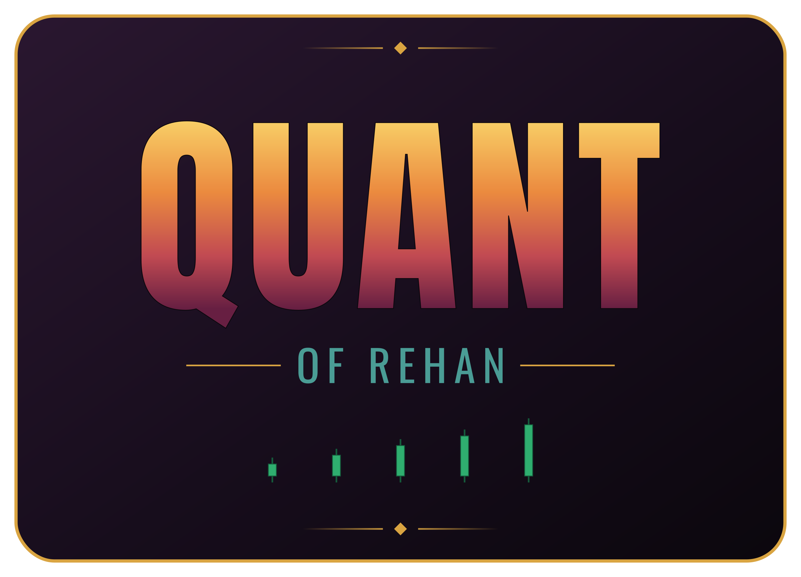

# Quant of Rehan



[](https://github.com/muhammadrehanqureshi/quant-of-rehan/actions/workflows/governance-guard.yml)
[](https://github.com/muhammadrehanqureshi/quant-of-rehan/actions/workflows/android-apk.yml)

**Private, signal-only intraday research platform for PSX KMIALL stocks.**
No order placement, no broker trading integration: signals and research only.

## Contributors

| Name | Role |
|---|---|
| [Mr. Rehan](https://github.com/muhammadrehanqureshi) | Owner and sole human author (SO-7). Decision authority for every rule in [GOVERNANCE.md](GOVERNANCE.md). |
| Codebuff AI agent | Co-author on every commit, pull request and merge, per SO-7a. Writes and lands the code, never decides the law. |

## The strategy in one paragraph

Scan the current KMIALL universe for one ICT/SMC setup: a confirmed sell-side
sweep, a bullish market structure shift, a fair value gap retest in the
discount half of the band's range. A candidate only exists when the evidence
is fresh and confirmed on completed minutes; there is no momentum or RSI
fallback. Gate on market context: after a broad selloff, no trade. Take the
single highest scoring setup, enter on paper at the observed price, stop
under the swept low, target entry x 1.02, and lock the day. Entry and exit
intent only: nothing reaches a broker (SO-1).

## What is true today

- **One scanner**: [src/signals/momentum_scanner.py](src/signals/momentum_scanner.py)
  returns exactly one confirmed ICT/SMC long, NO TRADE, or DATA BLOCKED, with
  market context gating and late-entry refusal instead of any fallback signal.
- **One configuration surface**: [src/config.py](src/config.py) holds the
  target, the coverage floor, the SMC parameters, the scan cadence and the
  paper/live switch. Paper is the default; live is off.
- **One daily trade state**: [src/signals/trade_state.py](src/signals/trade_state.py),
  with a hard one-trade-per-day lock that survives a restart.
- **One market clock**: Asia/Karachi UTC+5 forever (SO-8), in
  [src/data/sessions.py](src/data/sessions.py). Bands: Mon to Thu 09:32 to
  15:30, Friday two sessions (09:17 to 12:00 and 14:32 to 16:30) with the
  midday break between them; weekends and PSX holidays closed. `market_phase()`
  answers CLOSED, PRE_OPEN, WARMUP, OPEN, BREAK or POST_CLOSE for every
  consumer, and `market_state_at()` answers the owner's four-state law
  (PRE_MARKET, MARKET, POST_MARKET, CLOSED): the quant never scans outside
  MARKET, and the phone can never show a break as ONLINE.
- **Bars come from the broker tape**, not the dead eClear OHLC servlet:
  [src/data/tape_bars.py](src/data/tape_bars.py) builds one minute of OHLC from
  the tape's own prices and takes volume from the venue's counter.
  [scripts/intraday_pipeline.py](scripts/intraday_pipeline.py) reads the tape
  first, falls back to an on-disk capture, and carries the source label into
  the observation and the phone card.
- **Buy/sell volume is measured, never guessed**:
  [src/data/tick_volume.py](src/data/tick_volume.py) classifies a print by
  where it landed against the tape's own bid and ask, and records what the
  wire cannot say (the side of an off-quote print) as unknown.
- **Honest data states**: a broken, thin, stale or volume-less source reports
  DATA BLOCKED with measured coverage, never a market verdict.

## How it runs

Everything recurring lives in the cloud and never on the owner's PC (SO-12,
owner order 2026-10-19). Both paths run with this machine switched off.

| | GitHub Actions | Cloudflare relay |
|---|---|---|
| Files | [intraday-session.yml](.github/workflows/intraday-session.yml) (the session loop) and [intraday-capture.yml](.github/workflows/intraday-capture.yml) (band slots, finalize, backstop) | [cloud/worker.js](cloud/worker.js) |
| Carries | the KMIALL scan, the post-close finalize, the observation both the phone card and the paper strategy read | the `/health`, `/signals`, `/market`, `/quotes` and `/prices` endpoints the phone reads |
| Cadence | **every second inside every PSX band** (`config.SCAN_INTERVAL_SECONDS = 1`, owner order 2026-10-19); one cycle costs about 2.9 s, so the loop runs back to back and the achieved rate is its own latency | on every band edge it is triggered for, and on every phone poll |
| Cost | nothing: free runner minutes on a public repository | the free edge tier |
| State | its own forward state on the runner | the `QuoteHub` Durable Object |
| PC off | yes | yes |

One scan serves both readers: the same run, observation and data-quality
report feed the phone card and the intraday paper strategy, so there is no
second, cheaper scan for the app.

Backtesting runs on Actions minutes by the owner's 2026-10-19 order, not on
the PC; the declared backtest entry points each call `guard_cloud_backtest`,
which refuses them outside a GitHub Actions job.

The old local runners are refused in code: the entry points call
`guard_owner_requested` from [src/ci/local_only.py](src/ci/local_only.py),
which passes inside Actions and refuses anywhere else. A local run the owner
asks for is enabled per process, in the shell that runs it:

```bash
QOR_OWNER_REQUESTED_LOCAL_RUN=scripts/kmiall_tick.py python scripts/kmiall_tick.py --status
```

## The phone app

`android/` is the companion console: v1.9.10 (versionCode 51), the owner's own
faces and palette, built with aapt2 and D8, no Gradle. It shows the status
pill with the relay's own phase sentence, the latest signal, and the market
card (KSE100 points and percentage, then the three volume leaders with their
counted buy/sell/total volumes). Search finds any symbol and shows a row that
re-styles in place every second while the panel is open: price, the day's
percent move in green or red, and the pinned tap answer, with a 30 second
staleness threshold that anything older is flagged against. It polls the edge
every second while the relay reports the market open, every 30 seconds when it
does not, and the broker-backed card on every live round; the status beacon
breathes only while a session is live, and the app never derives a session
from its own clock. See [android/README.md](android/README.md).

## Charts of Rehan

`charts/` is a standard-library Python service and `web/` its React and
TypeScript front end: candles, volume, measured missing minutes and the
exchange's session clock, drawn only from bars this project can name. It is a
foreground tool and nothing else: no schedule, daemon, watcher or autostart,
it refuses to start inside GitHub Actions, and it binds loopback unless the
operator says otherwise. `python examples/charts_demo.py` runs the whole
pipeline offline, `python -m charts --source tape --port 8788` serves real
bars on loopback, and `cd web && npm run dev` runs the UI with hot reload.
Full detail in [charts/README.md](charts/README.md) and
[web/README.md](web/README.md).

## Layout

```
src/config.py                     the ONE configuration surface
src/signals/momentum_scanner.py   the ONE scanner (ICT/SMC gates, one winner)
src/signals/smc.py                sweep, market structure shift, FVG retest
src/signals/trade_state.py        the persisted daily state and trade lock
src/signals/contracts.py          the typed boundary: models, faults, ingest guard
src/data/sessions.py              Karachi-pinned clock, session law, owner texts
src/data/tape_bars.py             intraday bars from the tape
src/data/feed_capture.py          the broker tick tape (banked once a live session)
src/data/tick_volume.py           buy/sell/total volume split from the tape
src/data/live_card.py             the live card the relay serves to the app
src/data/market_snapshot.py       KSE100 and the KMIALL volume leaders
src/ci/local_only.py              the guards that keep runtime work in the cloud
src/ci/budget.py                  adaptive Actions budget for a cycle
src/notify/telegram.py            env-driven notifier (fails closed)
scripts/intraday_pipeline.py      the orchestrator (scan, finalize, card, archive)
scripts/scan_loop.py              supervised interval scan loop (cloud runner)
scripts/land.sh                   stage, validate and land one change through a PR
scripts/check_governance.py       secret, style, identity and SO-8 enforcement
cloud/worker.js                   Cloudflare relay and edge crons (Karachi math)
android/                          companion app source
data/                             gitignored: datasets, journals, forward state
legacy/                           quarantined code from the deleted sentinel repos
```

## Standing orders (full text in [GOVERNANCE.md](GOVERNANCE.md))

1. **SO-1 Signal-only.** No order is ever placed, modified or cancelled.
2. **SO-2 / SO-6 Pull request first.** Every change lands as a PR that the
   agent opens and merges, never a direct push; `scripts/land.sh` does that
   flow.
3. **SO-3 Never fabricate data.** Coverage, prices, volume and verdicts are
   measured results only, never invented.
4. **SO-4 Backtests never on the owner's PC.** The owner's 2026-10-19 order
   moved all compute to Actions minutes; `guard_cloud_backtest` refuses every
   declared backtest entry point outside CI.
5. **SO-5 Secrets never enter the repo**, a log line or a message.
6. **SO-7 Sole human author, human style.** Every commit is authored by
   Mr. Rehan and em dashes are banned from commits and files.
7. **SO-7a The agent is the co-author.** Every commit, PR body and merge
   carries `Co-Authored-By: Codebuff <noreply@codebuff.com>`.
8. **SO-8 Karachi time forever.** UTC+5, hardcoded, no other zone.
9. **SO-9 Owner notifications** at open and close, through the relay.
10. **SO-12 / SO-13 Cloud cadence.** The one-second scan runs on Actions
    minutes and the Cloudflare relay, with the owner's PC switched off.

## Checks and commands

```bash
# the same checks CI runs (validation belongs in Actions, SO-21)
python scripts/check_governance.py
python -m unittest discover -s tests

# is the system working? one command, honest verdict
python scripts/verify_market_signals.py          # config, universe, state, AI, scheduler
python scripts/verify_market_signals.py --live   # also dial the relay and read the cards

# the scheduled cycle by hand (paper only, no orders)
python scripts/intraday_pipeline.py --scan --slot 10:00
python scripts/intraday_pipeline.py --finalize
```

## Documentation

- [GOVERNANCE.md](GOVERNANCE.md): the standing orders, in full.
- [MARKET_SCHEDULING.md](MARKET_SCHEDULING.md): the session law, the four
  states and the cadence decisions behind them.
- [DATA_SOURCING.md](DATA_SOURCING.md): every input, what is measured versus
  inferred, and what happens when a source goes quiet.
- [INTRADAY_FORWARD_SYSTEM.md](INTRADAY_FORWARD_SYSTEM.md): candidate
  registration, promotion and demotion rules, source checks, limitations.
- [RESEARCH_FINAL_AUDIT.md](RESEARCH_FINAL_AUDIT.md): the research results,
  the data limitations and the signal status.
- [DASHBOARD_ARCHITECTURE.md](DASHBOARD_ARCHITECTURE.md): the private console
  design on the owner's broker feed, with the measured capability matrix that
  decides what a footprint view may claim.
- [PROJECT_REPORT.md](PROJECT_REPORT.md): the long-form build record.
- [android/README.md](android/README.md), [charts/README.md](charts/README.md),
  [cloud/README.md](cloud/README.md): the three components in full.

## Status, 2026-10-21

- **Suite green**: the governance-guard run of 2026-10-20 09:59 UTC reports
  `Ran 1251 tests`, OK, on the merged master.
- **Every change lands as a pull request**: the `governance-guard` workflow
  must pass (governance check, the whole unit suite, the worker's JavaScript
  syntax) before the agent merges with a merge commit.
- **Signal-only and paper only**: live trading is disabled, and the paper
  gate needs genuinely accumulated forward sessions before it opens.
